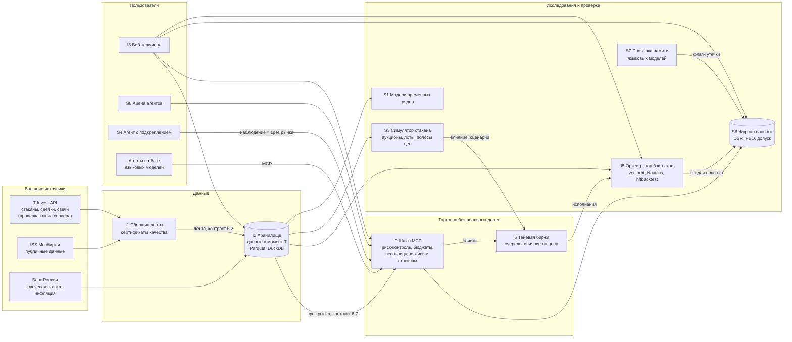

# Архитектура платформы Tradeq

Платформа состоит из независимых модулей, каждый модуль живет в своем репозитории и общается с другими по
HTTP через единые контракты из [prompts/00-platform-conventions.md](../../prompts/00-platform-conventions.md).
Ни один модуль не импортирует код другого, поэтому любой блок можно взять в другой проект.

## Схема

## Как идут данные

1. Сборщик I1 получает поток стаканов и сделок из T-Invest API, история свечей приходит запросами, а ISS
   закрывает периоды, которых нет у T-Bank
2. Хранилище I2 пишет каждую строку с двумя временами, временем события и временем, когда мы о нем узнали,
   поэтому любой запрос возвращает рынок ровно таким, каким он был известен в момент T
3. Срез рынка в момент T одинаков для обучения агента на истории, для торговли агента в песочнице и для
   экрана терминала
4. Каждый бэктест, каждая идея агента и каждый прогон обучения попадают в журнал S6 как попытка, а S6
   решает, пустить ли стратегию к реальному счету
5. Агенты торгуют только через шлюз I9, где у каждой заявки есть бюджет, проверка лотности и запись в журнале

## Хранилища

| Что | Где |
|---|---|
| Лента и свечи | Parquet по контракту 6.2, запросы через DuckDB |
| Живая лента | QuestDB (опционально) |
| Журнал попыток | DuckDB в модуле S6 |
| Сессии агентов | SQLite в модуле I9 |
| Корень данных | `TRADEQ_DATA_DIR`, общий для всех модулей |

## Модели

| Модель | Где работает | Что делает |
|---|---|---|
| Агент с подкреплением (PPO, SAC) | S4, контракт `rl/v1` | выбирает время, цену и объем заявок |
| Генеративная модель потока заявок (GRU) | S3 | воспроизводит реакцию рынка на наши заявки |
| Процессы Хоукса | S3 | моделируют поток заявок по типам |
| Модели временных рядов (Chronos, PatchTST) | S1 | дают прогноз и ранжирование бумаг |
| Языковые модели | S7, I9, S8 | читают новости, предлагают идеи, проходят проверку на утечку |
| Модель вероятности исполнения | I5 | калибрует исполнение лимитных заявок по реальным данным |

## Порты сервисов

S6 8601, I1 8602, I2 8603, S1 8604, S7 8605, I5 8606, I9 8608, S3 8609, I6 8610, I8 8611
