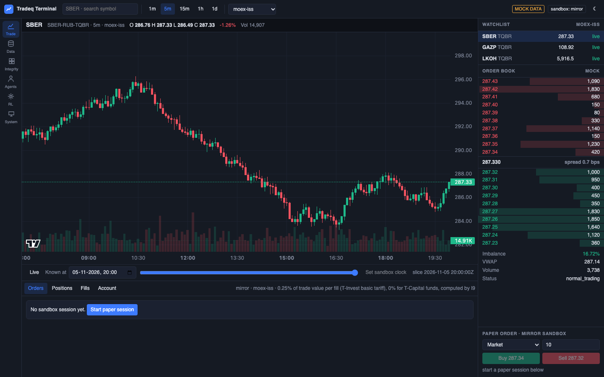
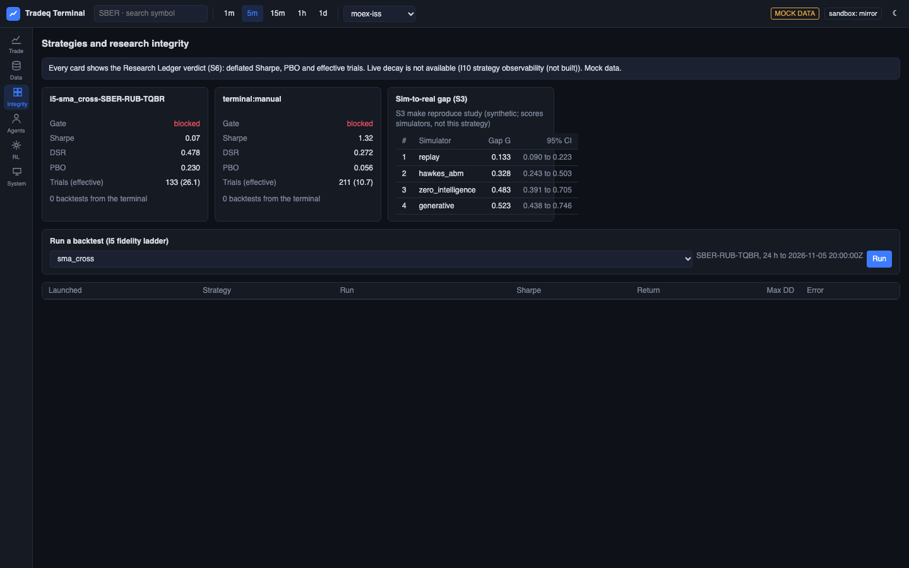
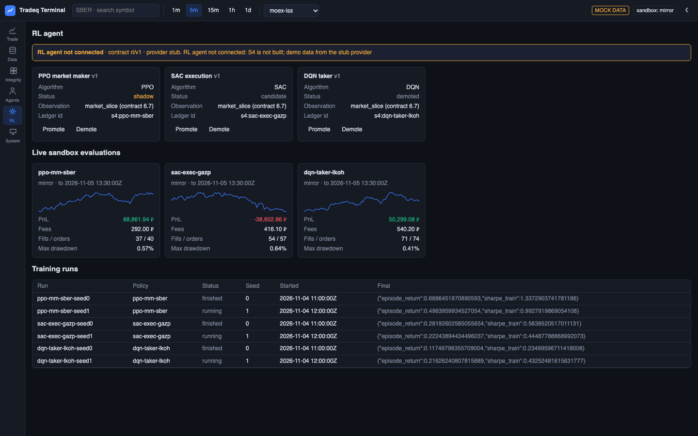
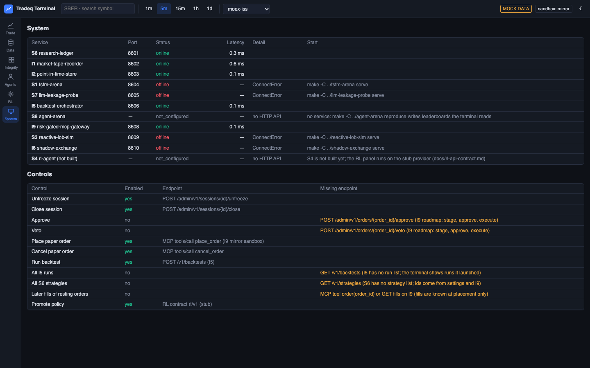

# Технический прототип

## Веб-терминал на тестовых данных

Терминал запускается одной командой и не требует биржи, токена или других сервисов, потому что встроенный
тестовый мир отвечает на все запросы.

```bash
git clone https://github.com/AlexAsadullin/research-terminal.git
cd research-terminal
cp .env.example .env            # укажите TRADEQ_DATA_DIR
make setup                      # Python .venv и node_modules
make reproduce                  # http://127.0.0.1:8611
```

Экраны открываются по адресу, например `http://127.0.0.1:8611/#rl` или `#system`.

### Торговый экран

Свечи и объем, стакан на 10 уровней с дисбалансом, лента наблюдения, машина времени по моменту T и бумажная
торговля в песочнице с комиссией 0,25%.



### Честность исследований

Вердикт журнала попыток по каждой стратегии, разрыв между симулятором и реальностью, запуск бэктеста.



### Агент с подкреплением

Политики, прогоны обучения и торговля агентов в песочнице по живым стаканам через контракт `rl/v1`.



### Состояние системы

Каждый сервис платформы со статусом, задержкой и командой запуска.



## Работа на реальных данных

```bash
cd market-tape-recorder && make setup        # нужен TBANK_TOKEN в .env, только чтение данных
cd .. && scripts/download-all.sh --smoke     # три бумаги, затем полный запуск без --smoke
cd point-in-time-store && .venv/bin/pit serve
cd ../research-terminal && make serve        # тот же интерфейс на реальных данных
```

Полная загрузка 6 ноября 2026 года заняла 3,5 часа и дала 829 744 дневных свечи и 28,6 млн минутных свечей
по 282 бумагам без единой ошибки.

## Модули

Каждый модуль запускается командами `make setup`, `make test` и `make reproduce`, а тесты работают без сети.
Список модулей и ссылки есть в [README](../../README.md#repository-index).
