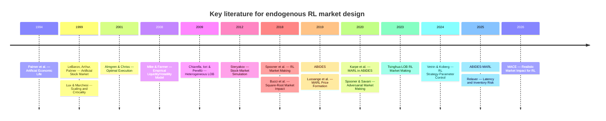

# Deep research: designing RL trading environments and endogenous stock-market simulations

## Executive summary

Your failure mode—100 RL agents independently discovering that buying pushes the price upward and then collectively staying long—is not primarily an “RL algorithm problem.” It is a **market-design and game-design problem**: if agents share similar objectives, face weak balance-sheet constraints, do not pay sufficiently for their own price impact, and trade in a market without heterogeneous liquidity supply or a fundamental anchor, then correlated buying can become individually rational and generate a self-reinforcing bubble. Research in agent-based computational finance, limit-order-book simulation, market-impact modeling, and multi-agent RL repeatedly shows that stable artificial markets require some combination of **conservation of cash/securities, heterogeneous participant types, inventory/margin constraints, realistic matching and queue rules, endogenous impact, calibrated cancellation/order-arrival processes, and validation against empirical stylized facts**. citeturn858691search0turn858691search2turn858691search3turn247420academia0

For your case, the most immediately useful sources are **ABIDES-MARL**, **ABIDES**, **Lussange et al.'s learning-agent stock market**, **Spooner et al.'s RL market maker**, **Mike–Farmer's empirical LOB model**, **Chiarella–Iori–Perelló's heterogeneous LOB**, and the recent **MACE market-impact environments**. Together they give a practical design recipe: use a true continuous double auction, conserve assets and cash, introduce asymmetric and heterogeneous objectives, charge nonlinear impact and liquidity costs, make inventory expensive, synchronize observations/actions correctly, and validate the resulting market before training powerful agents. citeturn718964academia8turn247420academia0turn410839academia5turn247420academia1turn858691search4turn858691search3turn546732academia7

## Core literature and corrective mechanisms

| Article name + link + year | Approach | Key problems described | Solutions provided |
|---|---|---|---|
| **Cheridito, Dupret, Wu — “ABIDES-MARL: A Multi-Agent Reinforcement Learning Environment for Endogenous Price Formation and Execution in a Limit Order Book”**, 2025. arXiv:2511.02016. [Original](https://arxiv.org/abs/2511.02016). **Language: English. Priority: High.** | Extends ABIDES-Gym into a synchronized multi-agent stochastic game with informed traders, liquidity traders, noise traders, and competing market makers. Liquidity and price impact emerge from strategic interaction rather than being fixed exogenously. citeturn718964academia8turn418259search6 | Fixed/exogenous impact models become structurally wrong when other traders adapt. The authors report that strategies learned under exogenous impact can perform poorly once market makers adapt; asymmetric information can lead market makers to exploit predictable execution and market dynamics can degenerate. citeturn418259search6 | Preserve price-time priority and ticks; synchronize adaptive agents; model heterogeneous roles; treat execution as a stochastic game; validate against an extended Kyle benchmark; expose agents to endogenous liquidity rather than a fixed price-impact curve. Code: a public proof-of-concept exists, but it is not clearly an author-official release; official code link **Not found**. citeturn718964academia8turn418259search4 |
| **Byrd, Hybinette, Balch — “ABIDES: Towards High-Fidelity Market Simulation for AI Research”**, 2019. arXiv:1904.12066. [Original](https://arxiv.org/abs/1904.12066). **English. High.** | Agent-based, discrete-event market simulator modeled on NASDAQ ITCH/OUCH; tens of thousands of agents, exchange agent, configurable pairwise latencies, market microstructure, Gym layer. citeturn247420academia0turn418259search0 | Simplistic backtests ignore latency, messaging, heterogeneous background flow, and the fact that an RL agent's own orders alter the market. A single “historical tape” is therefore not enough for strategic market training. citeturn247420academia0 | Use event-driven exchange mechanics, explicit network latency, realistic order protocols, stylized background traders, and empirical validation. The official JPMC repository provides market configurations with market makers, value, momentum, and noise agents. **Runnable multi-agent market: Yes.** Code: [JPMC ABIDES](https://github.com/jpmorganchase/abides-jpmc-public), archived/read-only since 2025; BSD-3-Clause. citeturn418259search0 |
| **Karpe, Fang, Ma, Wang — “Multi-Agent Reinforcement Learning in a Realistic Limit Order Book Market Simulation”**, 2020. arXiv:2006.05574. [Original](https://arxiv.org/abs/2006.05574). **English. High.** | Builds execution RL on ABIDES with historical LOB calibration and multiple background agents; DDQL chooses execution/order placement using HFT microstructure signals. citeturn718964academia9 | Execution policies trained without strategic/background market dynamics can exploit unrealistic fills or mis-estimate cost. Historical replay alone does not reproduce the feedback created by an agent's own orders. citeturn718964academia9 | Train against interacting background agents, compare simulation to market replay, expose the agent to realistic microstructure signals, and benchmark against TWAP-like execution. Code via ABIDES: [repository](https://github.com/abides-sim/abides). **Runnable multi-agent market: Yes.** citeturn418259search1turn718964academia9 |
| **Lussange et al. — “Stock price formation: useful insights from a multi-agent reinforcement learning model” / later journal version “Stock Price Formation: Precepts from a Multi-Agent Reinforcement Learning Model”**, 2019/2023. arXiv:1910.05137; *Computational Economics*. [Preprint](https://arxiv.org/abs/1910.05137). **English. High.** | Every trader independently learns forecasting and trading policies with model-free RL; all orders feed a centralized double-auction LOB. The study varies learning, chartist/fundamentalist tendencies, and information. citeturn410839academia5turn410839search2 | Market stability changes with agent learning rates and chartist/fundamentalist composition. Uniform adaptive behavior can reduce diversity; information and policy similarity alter collective price formation. citeturn410839academia5 | Maintain **policy heterogeneity**, parameter heterogeneity, fundamentalist components, different information sets, and an actual double-auction market. Better-performing agents in the later study tend to become more diverse and more fundamentalist, which is directly relevant to preventing one-directional monoculture. Code: **Not found**. citeturn410839search2 |
| **Lussange, Lazarevich, Bourgeois-Gironde, Palminteri, Gutkin — “Stock market microstructure inference via multi-agent reinforcement learning”**, 2019. arXiv:1909.07748. [Original](https://arxiv.org/abs/1909.07748). **English. High.** | Calibrates a learning-agent artificial market to London Stock Exchange data from 2007–2018; agents trade through a centralized book. citeturn410839search3 | A simulator may “look plausible” while having the wrong microscopic dynamics. Matching average prices is insufficient; microstructure statistics and autocorrelations can be wrong. citeturn410839search3 | Calibrate against real microstructure and validate price autocorrelation and other market statistics across several horizons. This is a strong warning against training RL before validating the simulator itself. Code: **Not found**. citeturn410839search3 |
| **Spooner, Fearnley, Savani, Koukorinis — “Market Making via Reinforcement Learning”**, 2018, AAMAS. arXiv:1804.04216. [Original](https://arxiv.org/abs/1804.04216). **English. High.** | High-fidelity LOB simulation plus SARSA-style temporal-difference RL with tile coding and an inventory-aware custom reward. citeturn247420academia1 | Market makers can accumulate large unfavorable inventories; pure PnL rewards fail to internalize inventory risk. citeturn247420academia1 | Add explicit inventory-risk terms to reward and state; train against a realistic LOB rather than unconstrained price series. Official code: [tspooner/rl_markets](https://github.com/tspooner/rl_markets), BSD-3-Clause. **Runnable LOB: Yes.** citeturn418259search3 |
| **Spooner, Savani — “Robust Market Making via Adversarial Reinforcement Learning”**, IJCAI 2020. DOI: 10.24963/ijcai.2020/633. [Publisher](https://www.ijcai.org/Proceedings/2020/633). **English. High.** | Turns Avellaneda–Stoikov market making into a two-player zero-sum game. The adversary represents adaptive market conditions/participants. citeturn718964search1turn247420academia2 | Single-agent policies overfit fixed environment dynamics and can be brittle when order-flow distributions or counterparties change. citeturn718964search1 | Adversarial training produces risk-averse behavior even without manually imposed penalties and improves robustness to model uncertainty. Official code: [tspooner/rmm.arl](https://github.com/tspooner/rmm.arl), BSD-3-Clause. **Multi-agent game: Yes, simplified adversary rather than full exchange population.** citeturn418259search2 |
| **Mike, Farmer — “An empirical behavioral model of liquidity and volatility”**, 2008, *Journal of Economic Dynamics and Control*. DOI: 10.1016/j.jedc.2007.01.025. [Publisher](https://www.sciencedirect.com/science/article/pii/S0165188907000450). **English. High.** | Empirical continuous-double-auction model calibrated from London Stock Exchange order placement, cancellation and sign dynamics. citeturn858691search4 | Arbitrary order generation creates unrealistic depth, spread and volatility. Large price changes depend strongly on gaps and liquidity distribution in the book, not only “fundamental” returns. citeturn858691search4 | Fit order placement/cancellation distributions and long-memory order flow to empirical data, then validate spread and volatility distributions out-of-sample on other stocks. Code: **Not found**. citeturn858691search4 |
| **Chiarella, Iori, Perelló — “The impact of heterogeneous trading rules on the limit order book and order flows”**, 2009, *Journal of Economic Dynamics and Control*. DOI: 10.1016/j.jedc.2008.08.001. [Publisher](https://www.sciencedirect.com/science/article/pii/S0165188908001437). **English. High.** | Order-driven LOB with heterogeneous fundamentalist, chartist and noise components; agents differ in horizon, risk aversion and strategy weights; order size comes from utility maximization. citeturn858691search3turn858691search5 | Homogeneous trading rules fail to reproduce important market statistics; chartist pressure can generate fat tails and volatility clustering; large gaps in the LOB can cause large price jumps. citeturn858691search5 | Build explicit trader heterogeneity, risk aversion and time horizons; use utility-based sizing rather than fixed unit orders; track gaps/depth. This is directly relevant to your 100 identical-learning-agent collapse. Code: **Not found**. citeturn858691search5 |
| **LeBaron, Arthur, Palmer — “Time series properties of an artificial stock market”**, 1999, *Journal of Economic Dynamics and Control*. DOI: 10.1016/S0165-1889(98)00081-5. [Publisher](https://www.sciencedirect.com/science/article/pii/S0165188998000815). **English. High.** | Santa Fe artificial stock market with adaptive AI traders and endogenous market-clearing prices. citeturn858691search0 | Adaptive agents can create volatility persistence, bubbles and technical predictability; the market does not automatically settle into a representative-agent equilibrium. citeturn858691search0 | Use heterogeneous adaptive expectations and explicit market clearing, and validate whether the artificial market reproduces real stylized facts. For your system, the key lesson is that equilibrium/stability is an **emergent property that must be tested**, not assumed. Code: **Not found**. citeturn858691search0 |
| **Lux, Marchesi — “Scaling and criticality in a stochastic multi-agent model of a financial market”**, 1999, *Nature* 397:498–500. [Publisher](https://www.nature.com/articles/17290). **English. High.** | Fundamentalists plus optimistic/pessimistic noise traders; agents switch strategies and sentiment endogenously. citeturn858691search2turn858691search8 | Herding and chartist feedback can produce large fluctuations and volatility clustering even when exogenous news itself has no such structure. citeturn858691search2 | Include a stabilizing fundamentalist population that sells when price exceeds fundamental value and buys when below it; allow strategy switching rather than locking every agent into the same objective. Code: **Not found**. citeturn858691search8 |
| **Abbade, Costa — “Realistic Market Impact Modeling for Reinforcement Learning Trading Environments”**, 2026. arXiv:2603.29086. [Original](https://arxiv.org/abs/2603.29086). **English. High.** | Three Gymnasium RL environments with pluggable Almgren–Chriss and square-root market-impact models, permanent impact with decay, and trade-level logging. citeturn546732academia7 | Fixed or negligible costs cause agents to learn pathological turnover and strategies that fail under realistic execution; algorithm rankings change materially when impact is modeled. citeturn546732academia7 | Nonlinear temporary/permanent impact, impact decay, explicit execution costs, and hyperparameter optimization. Their experiments reduce daily costs from about $200k to $8k and turnover from 19% to 1% in one setting. Code is stated as open source, but an author-official repository link was **Not found** in the sources I could verify. citeturn546732academia7 |
| **Almgren, Chriss — “Optimal execution of portfolio transactions”**, 2001, *Journal of Risk*. DOI: 10.21314/JOR.2001.041. [DOI](https://doi.org/10.21314/JOR.2001.041). **English. High.** | Mathematical execution model balancing volatility risk against temporary and permanent market impact. citeturn546732search1 | Ignoring execution cost lets a strategy move arbitrarily much volume with unrealistically little economic penalty. citeturn546732search1 | Penalize temporary and permanent impact and optimize the cost-risk frontier. For your simulator this is a useful **floor model** even if the actual impact comes endogenously from the book. Code: **Not found**. citeturn546732search1 |
| **Bucci, Benzaquen, Lillo, Bouchaud — “Crossover from Linear to Square-Root Market Impact”**, 2018/2019. arXiv:1811.05230. [Copy](https://www.cfm.com/wp-content/uploads/2022/12/120-Crossover-from-linear-to-square-root-market-impact.pdf). **English. High.** | Empirical analysis of ~8 million institutional trades; studies linear-to-square-root impact crossover. citeturn546732search8 | Assuming price impact is always linear is empirically wrong at large metaorder sizes; persistent one-sided order flow interacts with available liquidity. citeturn546732search8 | Calibrate a nonlinear impact rule from order size relative to market liquidity/volume. Do **not** use a fixed “every buy moves price +x” mechanism. Code: **Not found**. citeturn546732search8 |
| **Jiang et al. — “Resolving Latency and Inventory Risk in Market Making with Reinforcement Learning”**, 2025. arXiv:2505.12465. [Original](https://arxiv.org/abs/2505.12465). **English. High.** | Realistic MM environment with 30–100 ms random order/data delays and 500 ms batch matching; state/action includes order hold time; DP-guided exploration and trend predictor. citeturn247420academia3 | Ignoring latency causes unintended cancellations, stale decisions and inventory accumulation. citeturn247420academia3 | Simulate message/placement delay, matching cadence and order holding time; explicitly manage inventory under delayed execution. Code: **Not found**. citeturn247420academia3 |
| **Gao et al. — “DeepScalper: A Risk-Aware Reinforcement Learning Framework to Capture Fleeting Intraday Trading Opportunities”**, 2022, ACM CIKM. DOI: 10.1145/3511808.3557283. [DOI](https://doi.org/10.1145/3511808.3557283). **English. Medium.** | Branching dueling Q-network, temporal encoder/decoder, hindsight bonus and risk-aware auxiliary task for intraday trading. citeturn718964search0 | Large combinatorial action spaces and transient opportunities are hard for ordinary single-head policies; profit-only rewards can ignore risk. citeturn718964search0 | Factor the action space into branches; add explicit risk-aware auxiliary learning and hindsight reward. Official implementation is available through the broader TradeMaster codebase, but paper-specific pretrained weights were not verified in prior artifact research. |
| **Palmer et al. — “Artificial economic life: a simple model of a stockmarket”**, 1994, *Physica D*. DOI: 10.1016/0167-2789(94)90287-9. [Publisher](https://www.sciencedirect.com/science/article/pii/0167278994902879). **English. Medium.** | Early adaptive-agent artificial market with emergent endogenous price series. citeturn858691search1 | Adaptive interacting traders can generate bubbles, crashes and persistent volume rather than converging to equilibrium. citeturn858691search1 | Treat instability as a structural property of interacting learning populations; test regime sensitivity rather than assuming convergence. Code: **Not found**. citeturn858691search1 |
| **Стеряков А.А. — “Имитационное моделирование фондовых рынков” [*Simulation Modeling of Stock Markets*]**, 2012, *Vestnik Samara State Aerospace University*. [Publisher](https://journals.ssau.ru/vestnik/ru/article/view/1987). **Russian. High.** | Microscopic/agent-based one-stock exchange; endogenous price emerges from agents' mutual trading; the model is designed as a self-contained trading system. citeturn528480search0 | A market simulator must not generate price independently of counterparties and balance-sheet interaction; otherwise the “market” is not a closed trading system. citeturn528480search0 | Structure trading as mutual exchange between agents, with explicit order formation and price creation from internal exchange mechanics. The paper describes a Java “exchange simulator,” but public code: **Not found**. citeturn528480search0turn528480search45 |
| **Арбузов В.О. — “Имитационное моделирование микроструктуры фондового рынка на основе высокочастотной и трансакционной информации” [*Simulation Modeling of Stock-Market Microstructure Based on High-Frequency and Transaction Data*]**, 2015, *Global Markets and Financial Engineering*. [Publisher](https://1economic.ru/lib/9736). **Russian. High.** | Empirically calibrated microstructure simulator; explicitly moves beyond zero-intelligence simplifications; models order size, placement and participant classes. citeturn528480search2 | Zero-intelligence environments can miss regulation, heterogeneous participants, large orders and empirical LOB distributions, producing unrealistic market dynamics. citeturn528480search2 | Use empirical transaction/HFT data; model heavy-tailed order sizes, different participant types and cancellation/placement patterns; validate against stylized facts. A software complex is described, but code: **Not found**. citeturn528480search2turn528480search6 |
| **Ветрин Р.Л., Коберг К. — “Обучение с подкреплением при оптимизации параметров торговой стратегии на финансовых рынках” [*Reinforcement Learning in Optimisation of Financial Market Trading Strategy Parameters*]**, 2024, *Computer Research and Modeling* 16(7), 1793–1812. DOI: 10.20537/2076-7633-2024-16-7-1793-1812. [Publisher](https://crm.ics.org.ru/journal/article/3569/). **Russian. Medium–High.** | Uses RL to tune parameters of established HFT/market-making strategies rather than letting an unconstrained policy invent all behavior. citeturn566502search4 | Pure DRL strategies are prone to overfitting, regime dependence and unstable results in HFT. citeturn566502search4 | Constrain RL to optimize parameters of known quantitative strategies, retaining economically meaningful structure and online adaptability. Code: **Not found**. citeturn566502search4 |
| **Бозина А.Н., Мартанус О.Р. — “Моделирование пузырей на фондовом рынке с учетом поведенческих факторов” [*Modeling of Financial Bubbles on the Basis of Behavioral Factors*]**, year/DOI **Not found** in accessible record. [CyberLeninka](https://cyberleninka.ru/article/n/modelirovanie-puzyrey-na-fondovom-rynke-s-uchetom-povedencheskih-faktorov). **Russian. Medium.** | Agent heterogeneity: conservative, speculative and noise traders; models herding, bounded rationality and irrational expectations. citeturn615403search1 | Herd behavior and common optimism can generate bubbles; homogeneous behavior is unrealistic and destabilizing. citeturn615403search1 | Include multiple investor classes; conservative/fundamentalist agents act as a restoring force when price deviates from fundamental value. Code: **Not found**. citeturn615403search1 |
| **干儒骁 — “深度强化学习在优化股票投资交易成本中的应用” [*Application of Deep Reinforcement Learning in Optimizing Stock Trading Transaction Costs*]**, 2023, Tsinghua University master's thesis. DOI: **Not found**. [University record](https://newetds.lib.tsinghua.edu.cn/). **Chinese. High.** | Deep-RL portfolio/trading-cost optimization with explicit market-impact modeling; compares alternative impact specifications. | The research focus is that transaction/impact assumptions materially change the learned policy; simplistic execution-cost models can make strategies appear profitable that would not survive real execution. This aligns with the broader market-impact evidence. citeturn893012search3turn546732academia7 | Include explicit impact costs and empirically grounded nonlinear response to trading participation, volatility and liquidity. Code: **Not found**. |
| **“基于限价订单簿的强化学习股票做市算法研究” [*Market Making with Deep Reinforcement Learning from Limit Order Books*]**, Tsinghua University thesis, 2023-era record. Author: **Not exposed in indexed record**. DOI: **Not found**. [University record](https://newetds.lib.tsinghua.edu.cn/qh/paper/summary?dbCode=ETDQH&sysId=281351). **Chinese. High.** | Event-driven LOB replay using Shenzhen Stock Exchange message/order data; Attn-LOB representation, continuous MM actions, hybrid reward; later proposes offline-RL system ORL4MM with mixed expert/random datasets. citeturn893012search0 | Handcrafted LOB features can be insufficient; online RL is data-inefficient and unstable; weak exploration and unrealistic state compression reduce robustness. citeturn893012search0 | Use event-driven order-book matching, pretrained representation learning, continuous MM action space, hybrid risk/PnL reward, and offline data combining random, fixed, Avellaneda–Stoikov and expert behavior. It also explicitly tests latency. Code: **Not found**. citeturn893012search0 |
| **“基于前沿强化学习技术的量化交易” [*Advanced Reinforcement Learning Methods for Quantitative Trading*]**, Tsinghua University thesis, 2024-era record. Author: **Not exposed in indexed record**. DOI: **Not found**. [University record](https://newetds.lib.tsinghua.edu.cn/qh/paper/summary?dbCode=ETDQH&sysId=290346). **Chinese. High.** | General framework spanning portfolio management, market making and execution; combines realistic problem modeling, representation learning and expert data. citeturn893012search1 | Identifies three recurring failures: oversimplified problem/action spaces, inability to represent high-dimensional market state, and ineffective exploration from scratch. citeturn893012search1 | Preserve realistic action space, use learned representations, and bootstrap from heterogeneous expert/behavioral data rather than identical agents learning de novo. Code: **Not found**. citeturn893012search1 |
| **“基于机器学习的中国证券市场冲击成本预测” [*Prediction of the Impact Cost in China Market Based on Machine Learning*]**, Tsinghua University thesis, 2023-era record. DOI: **Not found**. [University record](https://newetds.lib.tsinghua.edu.cn/qh/paper/summary?dbCode=ETDQH&sysId=284132). **Chinese. Medium–High.** | Uses Level-2 data and simulated TWAP executions to model Chinese equity impact costs; identifies participation, volatility, liquidity and price as important drivers. citeturn893012search3 | A constant commission cannot represent the true cost of aggressive buying. Impact depends on volume participation and liquidity. citeturn893012search3 | Make impact depend on participation rate, volatility and liquidity; separate temporary and permanent components. Code: **Not found**. citeturn893012search3 |

The earlier Russian-language research notes you supplied independently converged on the same themes: closed-market conservation, heterogeneity, realistic clearing, market impact and stylized-fact validation. fileciteturn0file0 The prior Chinese-language research notes likewise highlighted endogenous impact, agent heterogeneity and LOB frictions as the main defenses against collective one-directional collapse. fileciteturn0file1

## Why your 100-agent market ran away

Your symptom is best understood as a combination of **reward hacking, missing conservation constraints, endogenous herding, and absent countervailing liquidity**. The literature does not imply that simply hiding the identities or policies of other agents prevents coordination: prices and the order book themselves are shared public signals, so identical learners can synchronize indirectly through environmental feedback. Lux–Marchesi shows how imitation/order-flow feedback creates collective regimes, while Lussange et al. show that learning rates and the chartist/fundamentalist composition materially affect stability. citeturn858691search2turn410839academia5

The critical mechanics to audit are:

1. **Balance-sheet conservation.** Every purchase must transfer cash from buyer to seller, and every share must come from an existing holder, borrowing facility, issuer, or market maker. Do not allow agents to acquire arbitrary net long inventory by “buying from the environment.” Closed-market Russian agent-based work explicitly models a fixed quantity of money and goods as a stabilizing structural assumption. citeturn615403search2

2. **Short selling must create a real liability.** A short sale needs borrowed stock, margin, borrow fees, maintenance requirements and forced liquidation. Otherwise “short” is not the economic mirror of “long.” If both long buying and short selling can create unlimited inventory from nowhere, the market's conservation laws are broken.

3. **A trade requires a counterparty.** A continuous double auction matches crossing bids and asks; a buy order does not by itself create a trade or an arbitrary upward price update. ABIDES and empirical LOB models use explicit exchange/matching mechanics. citeturn247420academia0turn858691search4

4. **Price should come from transactions/book state, not reward-oriented pressure rules.** If your simulator says “net buy flow = positive price drift” independently of actual liquidity and fills, agents have discovered a lever that prints mark-to-market profit. Mike–Farmer and Chiarella–Iori–Perelló instead produce prices from the evolving book, where depth, gaps, cancellations and market/limit order flow determine what can actually transact. citeturn858691search4turn858691search5

5. **Mark-to-market profit is unsafe by itself.** If an agent can move the last price upward with its own trade and immediately receive reward on a large existing position, it is effectively rewarded for self-induced valuation. Inventory-aware market-making work addresses this by penalizing inventory and execution risk, while impact models charge for aggressive trading. citeturn247420academia1turn546732academia7

6. **Identical populations are unstable.** If 100 agents have the same state, architecture, reward and learning schedule, stochasticity alone may not create useful economic heterogeneity. Classical and modern agent-based models intentionally mix value/fundamental, momentum/chartist, noise, liquidity, informed and market-making roles. citeturn858691search8turn418259search0turn718964academia8

7. **Training everybody simultaneously changes the environment continuously.** Each learner sees a non-stationary transition kernel because all other policies are updating. ABIDES-MARL explicitly treats the system as a stochastic game and synchronizes decision periods to preserve information filtration. citeturn718964academia8

8. **Matching latency matters.** With simultaneous agents, event ordering can create artificial first-mover advantages or stale-state exploitation. ABIDES models communication latency, and Relaver shows that even tens of milliseconds of delay can alter inventory and cancellation outcomes. citeturn418259search0turn247420academia3

## Prioritized reading list

**1. ABIDES-MARL — Cheridito, Dupret, Wu (2025).**  
[arXiv](https://arxiv.org/abs/2511.02016). This is the closest direct analogue to your system: adaptive heterogeneous agents interact in an endogenous LOB, and the paper explicitly warns that dynamics can degenerate when adaptive liquidity providers exploit predictable traders. Read this first for multi-agent scheduling, roles, endogenous liquidity and equilibrium testing. citeturn718964academia8turn418259search6

**2. ABIDES — Byrd, Hybinette, Balch (2019).**  
[Paper](https://arxiv.org/abs/1904.12066) · [Official code](https://github.com/jpmorganchase/abides-jpmc-public). This is the strongest engineering reference for building the exchange layer correctly: event-driven messaging, price-time priority, latency, exchange agents and heterogeneous background populations. citeturn247420academia0turn418259search0

**3. Lussange et al. — Stock Price Formation (2019/2023).**  
[arXiv](https://arxiv.org/abs/1910.05137). This paper is highly relevant to the “all agents learn the same thing” issue because it examines how learning, chartist/fundamentalist preferences and information affect market stability and strategy heterogeneity. citeturn410839academia5turn410839search2

**4. Chiarella, Iori, Perelló — Heterogeneous Trading Rules and the LOB (2009).**  
[Publisher](https://www.sciencedirect.com/science/article/pii/S0165188908001437). Read this for a clean economic argument that heterogeneous horizons, risk aversion, fundamentalist/chartist/noise components and utility-based order sizing are not decorative—they are part of what produces realistic order flow and price statistics. citeturn858691search3turn858691search5

**5. Mike & Farmer — Empirical Behavioral Model of Liquidity and Volatility (2008).**  
[Publisher](https://www.sciencedirect.com/science/article/pii/S0165188907000450). This is the best source here for calibrating the order book itself: placement, cancellation, liquidity gaps, spread and volatility should be validated against data before RL is introduced. citeturn858691search4

**6. Spooner et al. — Market Making via Reinforcement Learning (2018).**  
[Paper](https://arxiv.org/abs/1804.04216) · [Code](https://github.com/tspooner/rl_markets). This gives a concrete inventory-aware reward and runnable LOB simulator; it is useful for replacing pure PnL with risk-sensitive objectives. citeturn247420academia1turn418259search3

**7. Abbade & Costa — Realistic Market Impact Modeling for RL Trading Environments (2026).**  
[arXiv](https://arxiv.org/abs/2603.29086). This directly addresses the common simulator error of using only a fixed commission. Their results show that realistic nonlinear impact radically changes turnover, costs and even which RL algorithm looks best. citeturn546732academia7

**8. Tsinghua — “基于限价订单簿的强化学习股票做市算法研究” / *Market Making with Deep Reinforcement Learning from Limit Order Books*.**  
[University record](https://newetds.lib.tsinghua.edu.cn/qh/paper/summary?dbCode=ETDQH&sysId=281351). This is especially useful for engineering the state/action/reward side: event-driven LOB reconstruction, learned representation, continuous MM actions, latency experiments and offline RL with mixed expert/random behavior. citeturn893012search0

## Implementation notes for rebuilding your environment

The safest architecture is to separate the simulation into **exchange mechanics**, **economics**, **agent policies**, and **validation**. ABIDES is a good template for this separation, and its official configurations are informative: instead of 100 identical RL traders, the standard market configurations combine market makers, value traders, momentum traders and hundreds or thousands of noise agents. citeturn418259search0

For the exchange engine, implement a proper continuous double auction with price-time priority, discrete tick size, partial fills, cancellation, self-trade prevention and explicit queue position. Do not allow an unmatched buy to “move the stock price” by fiat; price changes should emerge from executions and the shape of the book. If you batch simultaneous actions, define deterministic or randomized ordering carefully and expose a consistent snapshot to agents. ABIDES-MARL's synchronization design exists precisely because naïve multiple Gym interruptions create inconsistent information timing. citeturn718964academia8turn247420academia0

For economics, enforce invariants every step: **sum of cash + exchange fees must be conserved; total issued shares plus borrowed shares/short liabilities must reconcile; no account may violate cash/margin constraints; every filled share has both buyer and seller**. A useful practical precedent is the current open-source continuous-double-auction environment `gym-continuousDoubleAuction`, which explicitly checks that total NAV plus fees equals starting cash and implements margin, liquidation, self-match prevention, maker/taker fees, batch or sequential clearing, and action masking. It is not one of the peer-reviewed sources above, so treat it as an engineering reference rather than evidence. [Code](https://github.com/ChuaCheowHuan/gym-continuousDoubleAuction). citeturn546732search6

For rewards, avoid simply giving every agent change in marked portfolio value. A robust market-maker reward can be structured schematically as

\[
r_t =
\Delta \mathrm{Cash}_t
+ \Delta \mathrm{RealizedPnL}_t
+ \Delta \mathrm{InventoryValue}_t
-\lambda_q q_t^2
-\lambda_{\mathrm{impact}} C_t
-\lambda_{\mathrm{turn}} |\Delta q_t|
-\lambda_{\mathrm{dd}}\,\mathrm{Drawdown}_t
\]

where `InventoryValue` should use a defensible liquidation mark, not a price an agent can trivially manipulate with a tiny self-induced trade. Inventory penalties have direct precedent in RL market making, and nonlinear execution costs have strong empirical and recent RL-environment support. citeturn247420academia1turn546732academia7turn546732search8

For population design, start with perhaps **10–20% value/fundamental agents**, **10–20% market makers**, **10–20% momentum agents**, **some noise/liquidity traders**, and only a subset of adaptive RL agents. Those percentages are an engineering starting hypothesis, not a literature-prescribed parameter range. The literature strongly supports heterogeneity, but the exact mix must be calibrated to the stylized facts you want to reproduce. Lux–Marchesi and Chiarella–Iori–Perelló are the key theoretical references here. citeturn858691search8turn858691search5

Do not train all 100 policies from scratch simultaneously at first. Use staged training: freeze a calibrated non-learning population; train one RL agent; then several independent agents; then introduce populations of frozen historical checkpoints; finally train multiple adaptive agents together. Adversarial training and population/self-play methods are better ways to expose a policy to strategic opponents than having 100 identical learners chase the same reward at once. Spooner–Savani provides a market-specific example of the adversarial approach. citeturn247420academia2

Before RL, validate the simulator against **stylized facts**: return distribution/heavy tails, near-zero raw return autocorrelation, positive volatility clustering, realistic spread distribution, depth distribution, order-size distribution, cancellation rates, volume–volatility relationship, and price response to signed order flow. Mike–Farmer, Chiarella–Iori–Perelló and the Lussange microstructure study all treat this calibration/validation step as central. citeturn858691search4turn858691search5turn410839search3

## Publication timeline

The progression is important: early agent-based economics established that bubbles and crashes can emerge from interacting heterogeneous agents; microstructure research then calibrated realistic order arrival/cancellation and impact; recent RL work adds strategic learning, synchronization, offline data and adversarial robustness. citeturn858691search1turn858691search2turn858691search4turn247420academia0turn718964academia8turn546732academia7

## Practical diagnosis and first fixes

For your specific system, I would treat these as the **first six blockers before training another 100 agents**:

- **Enforce conservation:** no purchase without seller, no unlimited cash, no unbacked stock creation, and real short-borrow/margin accounting.
- **Make the LOB the price-formation mechanism:** executions, book depletion and queue gaps create prices; do not separately add price drift from net buying.
- **Charge endogenous impact:** at minimum, make aggressiveness/size costly as a function of liquidity and participation; ideally let impact emerge from consuming the actual book, with an additional calibrated temporary/permanent impact model only where needed.
- **Penalize inventory and turnover:** mark wealth at a liquidation-aware price and impose explicit inventory risk.
- **Break policy monoculture:** use several economically distinct populations and different objectives/information sets.
- **Validate without RL first:** if zero-intelligence/value/momentum/market-maker populations cannot produce a stationary, plausible market with stable accounting, RL will learn to exploit the defect rather than fix it. These recommendations follow directly from the combined evidence in ABIDES, Lussange, Spooner, Mike–Farmer, Chiarella–Iori–Perelló, Lux–Marchesi and MACE. citeturn247420academia0turn410839academia5turn247420academia1turn858691search4turn858691search5turn858691search2turn546732academia7

**Verification date: 2026-11-10.** I prioritized publisher pages, arXiv records, university repositories and official GitHub repositories; DOI or code fields that I could not establish from primary or authoritative sources are explicitly marked **Not found**.